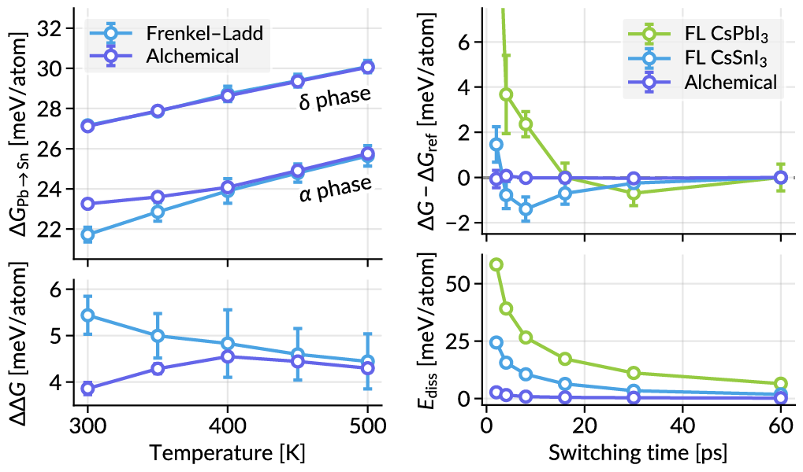

## My matplotlib preset
> *Flavored with [Lato fonts](https://www.latofonts.com) and [tailwindcss](https://tailwindcss.com) color palette!*

> [!CAUTION]
> This repository has been released as a preliminary version and may not be ready for production use. I'll work on refining colors and options in future updates.

### Installation on Linux
1. Download the Lato font from the [official website](https://www.latofonts.com/lato-free-fonts/) (do not install it from Google Fonts, as it is an older version).
2. On Linux, copy the ttf files to the `~/.local/share/fonts/` directory and run `fc-cache -fv ~/.local/share/fonts/` to update the font cache.
3. To use as the default matplotlib style, copy the `matplotlibrc` file to your `~/.config/matplotlib/` directory.
4. *(optional)* Lato has no glyphs for some math symbols (∇, ∝, ⋅, ⟨ ⟩), so by default they come from Computer Modern. For symbols that match Lato, install the fonts in `math-font/` the same way as in step 2 and enable the commented block at the end of `matplotlibrc`. They are Lato plus the missing symbols from [Lete Sans Math](https://github.com/abccsss/LeteSansMath), under a new name as Lato's license requires; `math-font/build_math_font.py` rebuilds them from your own Lato files. Delete matplotlib's font cache (`~/.cache/matplotlib/fontlist-*.json`) afterwards so it finds the new fonts.

For other options, please refer to the [official documentation](https://matplotlib.org/stable/users/explain/customizing.html).

### Example figure

You may need to configure the marker sizes, line widths, etc. to fit your needs.

### More colors
See the [tailwindcss color palette](https://tailwindcss.com/docs/customizing-colors) for colorful inspiration!
